# 剧本：死后会变慢的钟

*ep22 · VIBE知识大赏 · 约2分钟 · 横屏 · 只有字幕 · 系列BGM（标题落在 drop 1 = 16.6秒，揭晓落在 drop 2 = 81.4秒，片尾卡 115.9秒起）· 夜间无人值守生成，2026-10-12*

**推荐标题：《死后会变慢的钟》**　备选：《距今几千年，怎么算的？》 / 《一块木炭有多老》  
**标题卡副标题：**碳14测年：数滴答，再对表  
**片尾评论区问题：**第一次听说"碳14"，你是在哪？  
**一句话带走：**活着的东西和空气同步"滴答"；死后每约5730年少一半——数剩下的滴答，再拿树轮对表，就知道它死了多久。

## 故事（三句话）

1. 博物馆展柜里一块木炭，标签只写"距今几千年"。活着时每克碳每分钟约滴答15下，死后越来越慢——你身上也有这只钟。
2. 1949年利比用年代已知的法老墓木头"考"这只钟，吻合得令人满意；1965年中国第一间碳14实验室成立前，也先用4块已知年代的木头考了一遍，全部对上。
3. drop 2：1960年代核试验让大气碳14约翻倍——"空气不变"的前提错了。于是用树轮做对照表校准；约5万年以上测不了；而核试验尖峰反倒成了1950年后的新钟。

## 需要你决定 / 注意

- **马王堆**：调研没找到马王堆碳14测年的具体结果（哪个样品、哪个实验室、多少年），所以片中**没有提马王堆**，用1965年中国第一间碳14实验室做中国线。如果你想要马王堆，需要去图书馆/知网查《考古》年度测年报告。
- 标题：默认「死后会变慢的钟」；ep24 已改成「他走后16年…」避免连着两集都用"死后…"。
- 还欠两条资料核对：「距今约4700年」的估算行、L24 原句的出处（已先用保守措辞「当年的吻合，是在误差范围内」）。

## 关键帧（11张，Tank/池塘同款2D画风；所有人物都通过了身体逻辑检查）

总览：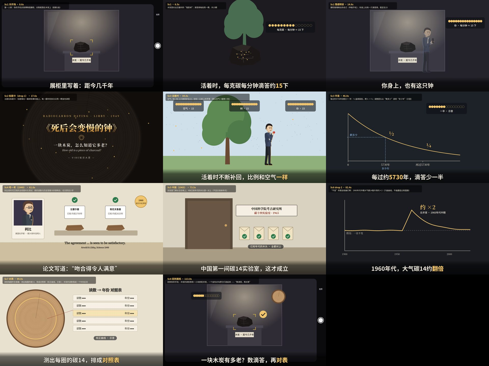

### Sc1 冷开场 · 0.6秒
第一人称：你的手机对准博物馆展柜，对焦框落在木炭上（踩第1拍）

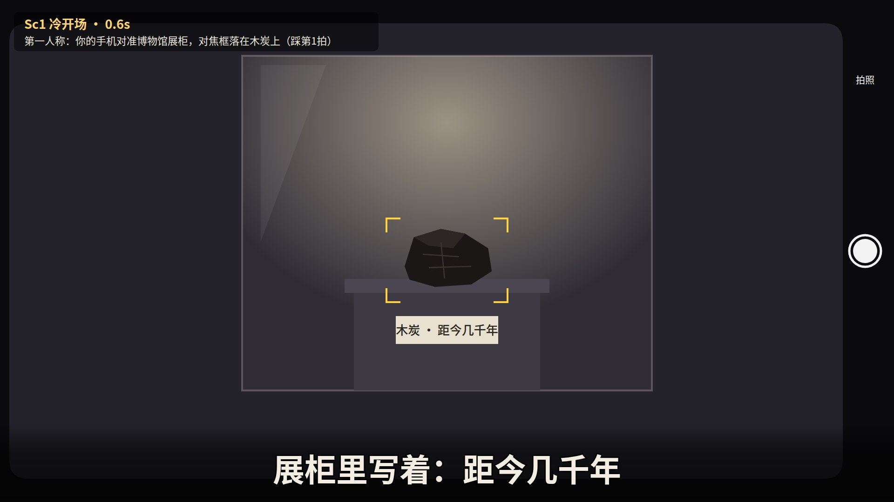

### Sc1 · 6.5秒
木炭里长出活着时的“鬼影树”；滴答表每拍亮一颗，共15颗

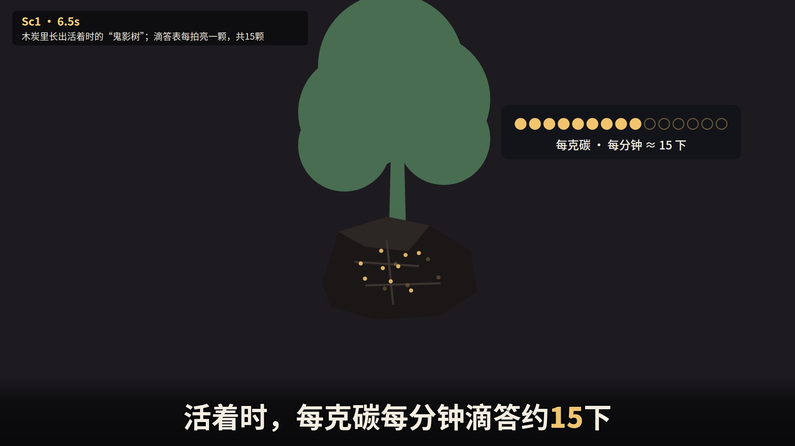

### Sc1 情感转折 · 14.6秒
展柜玻璃映出你自己（举着手机）；你身上也有一只滴答表，稳定在15

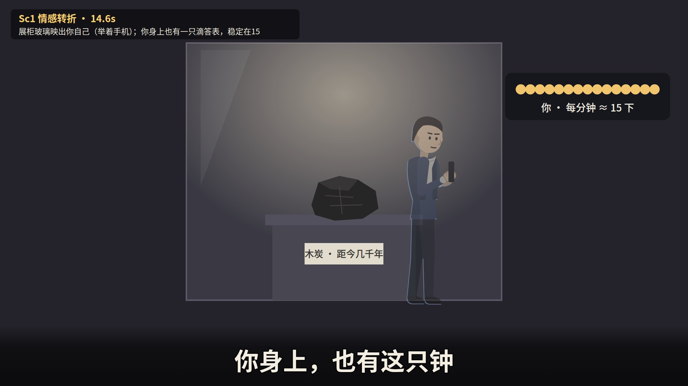

### Sc2 标题卡（drop 1） · 17.6秒
主题化标题卡：标题落在一截树轮横切面上，每一圈年轮依次点亮一颗金色滴答

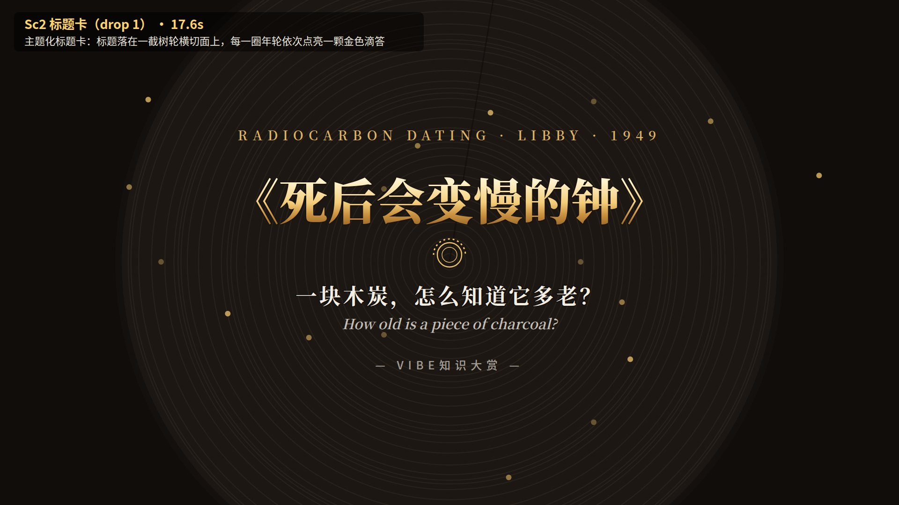

### Sc3 活着时 · 34.0秒
空气 / 树 / 你 三只表同步在15；你咬一口树上的苹果（碳从空气→植物→你）

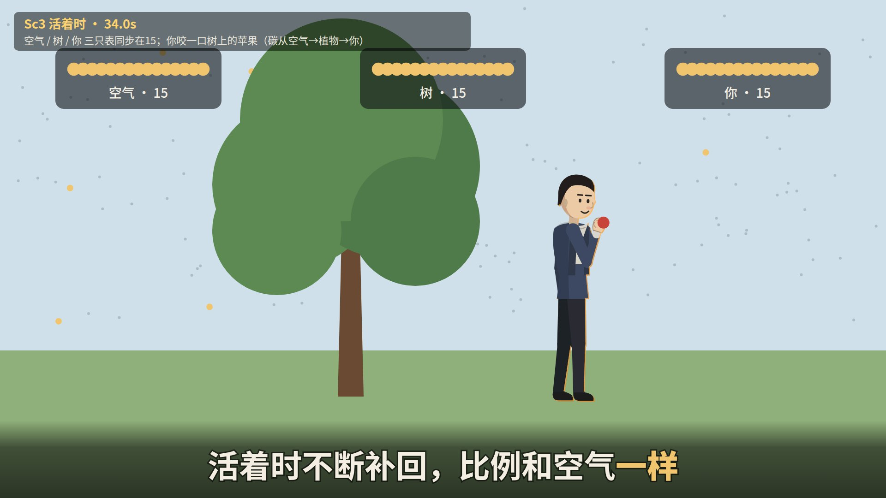

### Sc3 半衰 · 46.0秒
每过约5730年滴答少一半：½ 盖章踩拍，再½ → ¼；读数箭头从“剩多少”读到“多少年”（示意）

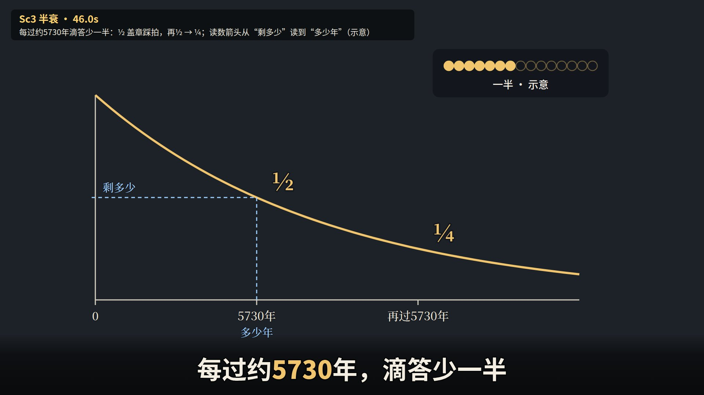

### Sc4 考一考（1949） · 61.0秒
利比用年代已知的法老墓木头测试：表的读数与历史答案卡并排吻合；论文原话小字

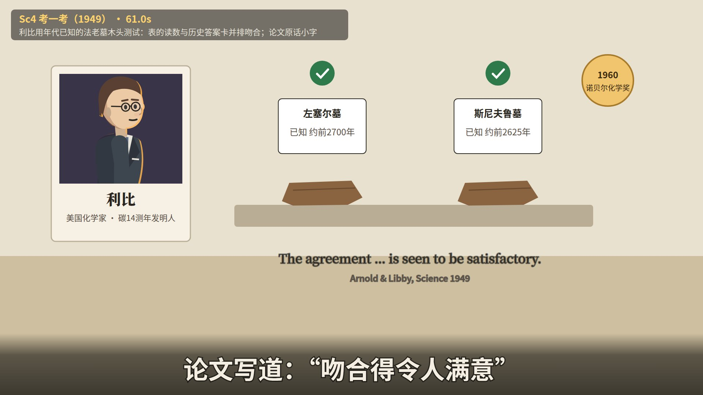

### Sc5 中国（1965） · 73.5秒
实验室门牌从空白填上；4块已知年代的木头逐一对上（不显示具体年代）

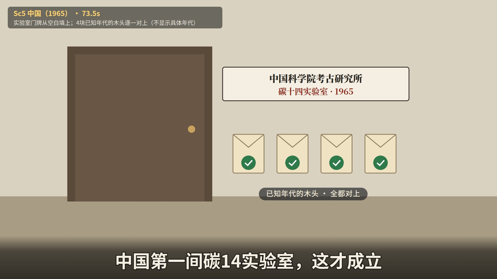

### Sc6 drop 2 · 82.4秒
“不变”的假设线被打断：1960年代中期大气碳14陡升到约×2（只画曲线，不画蘑菇云和国旗）

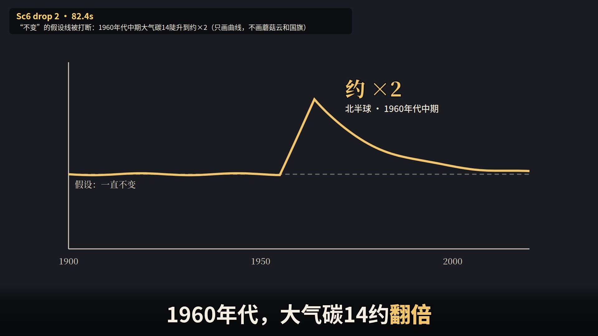

### Sc7 对表 · 99.0秒
树轮每圈年份准确：测出每圈的碳14，排成对照表（校正曲线，示意）；木炭的读数落成一个年份区间

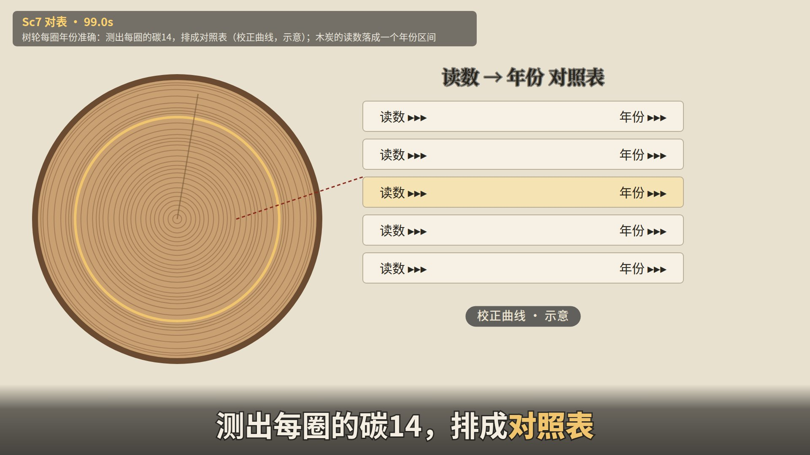

### Sc8 回到展柜 · 113.0秒
回到你的手机：木炭的滴答表和一小块树轮并排，一个金色对勾把它们连起来 ——“数滴答，再对表”

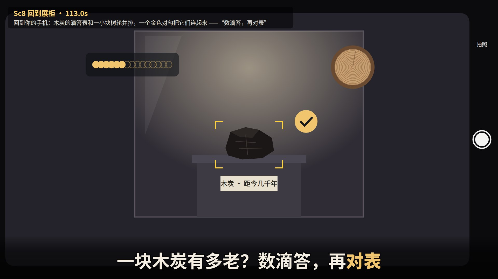

## 完整台词（时间轴）

| # | 开始 | 结束 | 台词（[金色]=重点词） | 所在场景 |
|---|---|---|---|---|
| 1 | 0.00 | 2.55 | 展柜里写着：距今几千年 | Sc1 |
| 2 | 2.65 | 5.06 | 可木炭身上，没写日期 | Sc1 |
| 3 | 5.16 | 8.29 | 活着时，每克碳每分钟滴答约[15]下 | Sc1 |
| 4 | 8.39 | 10.66 | 死后，滴答越来越[慢] | Sc1 |
| 5 | 10.76 | 13.60 | 剩几下，就能说出它死了多久 | Sc1 |
| 6 | 13.70 | 16.40 | 你身上，也有这只钟 | Sc1 |
| 7 | 20.80 | 26.14 | 空气里，有极少量的[碳14] | Sc2 |
| 8 | 26.24 | 31.71 | 碳14每衰变一个，就是一声[滴答] | Sc2 |
| 9 | 31.81 | 37.28 | 活着时不断补回，比例和空气[一样] | Sc2 |
| 10 | 37.38 | 42.85 | 死后不再补，只剩[衰变] | Sc3 |
| 11 | 42.95 | 48.95 | 每过约[5730]年，滴答少一半 | Sc3 |
| 12 | 49.10 | 51.96 | 这只钟准吗？发明人先[考一考] | Sc3 |
| 13 | 52.06 | 55.50 | 1949年，利比找来法老墓的木头 | Sc3 |
| 14 | 55.60 | 59.05 | 年代早已知道：距今约[4700年] | Sc3 |
| 15 | 59.15 | 63.10 | 论文写道：“吻合得令人满意” | Sc3 |
| 16 | 63.25 | 66.13 | 中国物理学家，拿到利比的书 | Sc4 |
| 17 | 66.23 | 69.17 | 1965年，实验室成立前先考一考 | Sc4 |
| 18 | 69.27 | 72.21 | [4]块已知年代的木头，全都对上 | Sc4 |
| 19 | 72.31 | 75.75 | 中国第一间碳14实验室，这才成立 | Sc4 |
| 20 | 75.85 | 79.30 | 这只钟的前提：空气里碳14[不变] | Sc5 |
| 21 | 81.45 | 84.36 | 1960年代，大气碳14约[翻倍] | Sc5 |
| 22 | 84.46 | 86.38 | 原因是[核试验] | Sc6 |
| 23 | 86.48 | 89.92 | 前提错了：空气里碳14一直在变 | Sc6 |
| 24 | 90.02 | 93.47 | 当年的吻合，是在误差范围内 | Sc6 |
| 25 | 93.57 | 97.52 | 要更准，拿[树轮]校准：每圈年份准确 | Sc6 |
| 26 | 97.62 | 101.06 | 测出每圈的碳14，排成[对照表] | Sc6 |
| 27 | 101.16 | 104.60 | 太老的不行：超过约[5万]年就剩太少 | Sc7 |
| 28 | 104.70 | 108.15 | 核试验尖峰后逐年回落，成了新的[钟] | Sc7 |
| 29 | 108.25 | 111.18 | 你身上的钟，跟着今天的空气 | Sc7 |
| 30 | 111.28 | 115.30 | 一块木炭有多老？数滴答，再[对表] | Sc7 |

## 资料

- 事实核查表：`facts.md`（每个数字都对应一行已核实的来源；没核实的不上屏）
- 英文工作版剧本（含每句画面说明、导演两轮意见）：`script.md`、`notes_gate1_r1.md`、`notes_gate1_r2.md`、`coldread_gate1.json`
- 下一步（等你确认标题和剧本后）：画风选择（gate 2a）→ 分镜 → 制作
