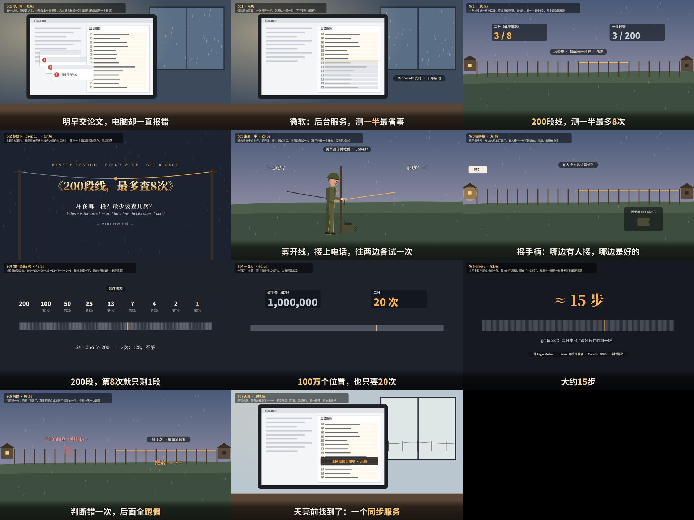
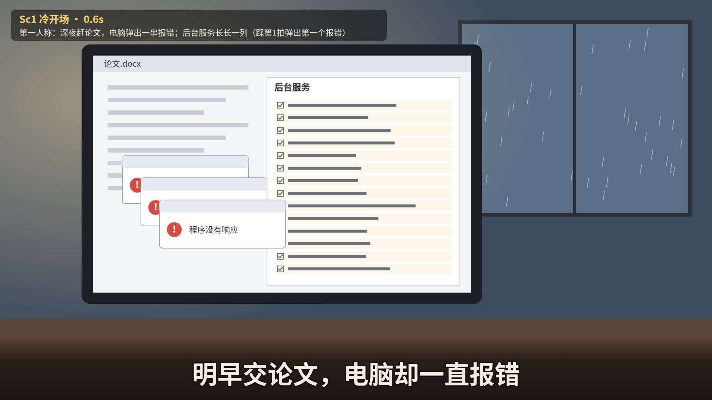
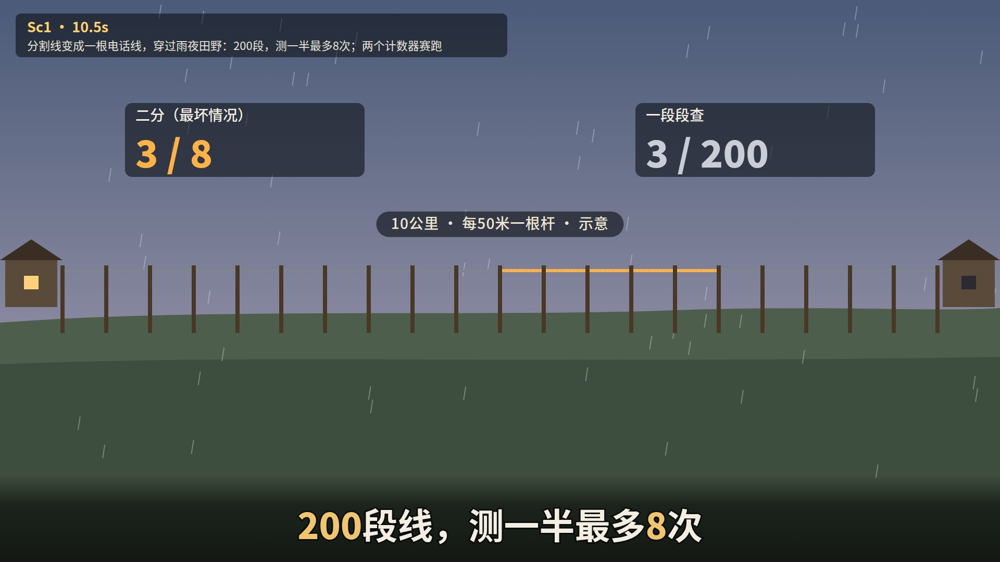
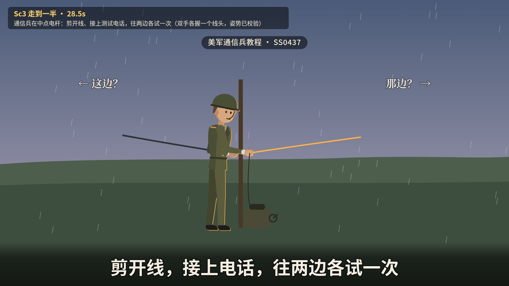
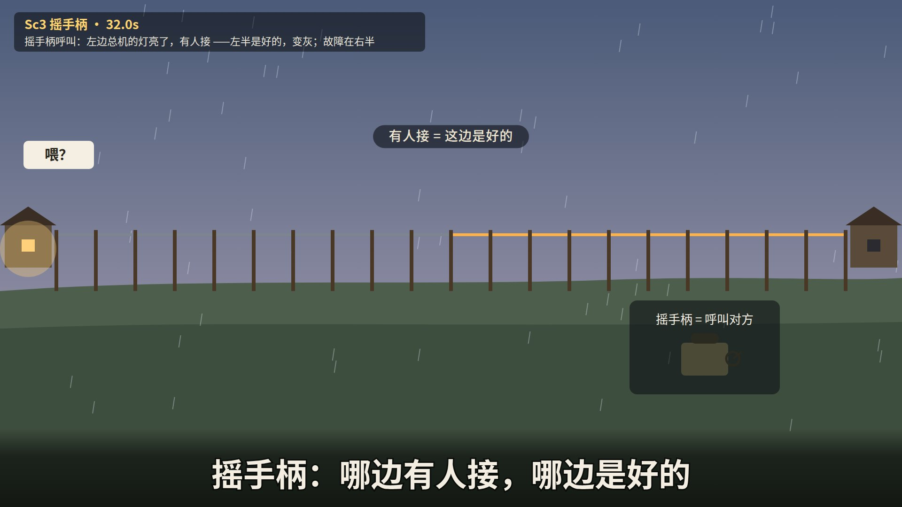
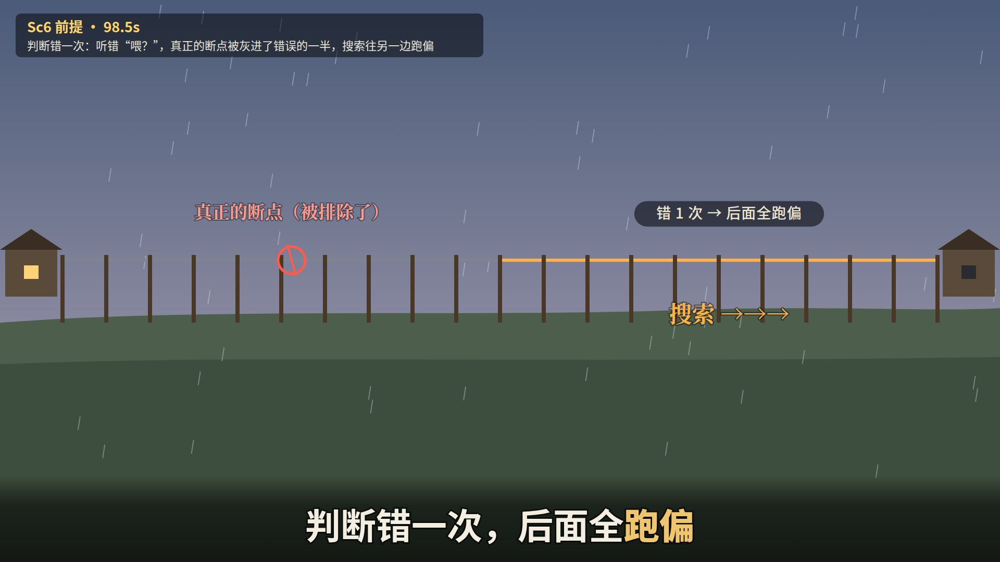

# 剧本：200段线，最多查8次

*ep23 · VIBE知识大赏 · 约2分钟 · 横屏 · 只有字幕 · 系列BGM（标题落在 drop 1 = 16.6秒，揭晓落在 drop 2 = 81.4秒，片尾卡 115.9秒起）· 夜间无人值守生成，2026-10-12*

**推荐标题：《200段线，最多查8次》**　备选：《线长一倍，只多查1次》 / 《一次测一半》  
**标题卡副标题：**每测一次，排除一半  
**片尾评论区问题：**这条断了的电话线，你在哪见过？  
**一句话带走：**不必一个个查——每次排除一半。线长一倍，只多查1次。

## 故事（三句话）

1. 交论文前夜电脑一直报错；微软官方的办法：后台服务一次只开一半。美军通信兵修电话线也这样找：200段线，最多8次（逐段查最坏要200次）。
2. 通信兵教程：走到一半、剪开线接上测试电话、往两边各摇一次——哪边有人接，哪边是好的；坏的那半再走到一半。2⁸=256≥200。线长一倍只多1次，100万个位置只要20次。
3. drop 2：程序员用同一招（git bisect）在上万个版本里找出"改坏软件的那一版"，大约15步。前提：只能有一处坏、每次测试都可靠；判断错一次就全盘跑偏。天亮前，电脑那边也找到了：一个同步服务（示意）。

## 需要你决定 / 注意

- "同步服务"和"明早交论文"是虚构的情景（标"示意"），没有品牌。
- gate 1 第二轮按导演意见又删了两句（"一位内核开发者…"和"15次对半…3.2万"），现在29句，等待时间约16%（比较松）。

## 关键帧（11张，Tank/池塘同款2D画风；所有人物都通过了身体逻辑检查）

总览：

### Sc1 冷开场 · 0.6秒
第一人称：深夜赶论文，电脑弹出一串报错；后台服务长长一列（踩第1拍弹出第一个报错）

### Sc1 · 4.0秒
微软官方建议：一次只开一半。列表从中间一刀，下半变灰（踩拍）

### Sc1 · 10.5秒
分割线变成一根电话线，穿过雨夜田野：200段，测一半最多8次；两个计数器赛跑

### Sc2 标题卡（drop 1） · 17.6秒
主题化标题卡：标题挂在两根电线杆之间的电话线上，正中一个剪口亮起琥珀色，雨丝斜落

### Sc3 走到一半 · 28.5秒
通信兵在中点电杆：剪开线、接上测试电话，往两边各试一次（双手各握一个线头，姿势已校验）

### Sc3 摇手柄 · 32.0秒
摇手柄呼叫：左边总机的灯亮了，有人接 ——左半是好的，变灰；故障在右半

### Sc4 为什么是8次 · 46.5秒
线拉直成200格：200→100→50→25→13→7→4→2→1，每拍灰掉一半；第8次只剩1段（最坏情况）

### Sc4 一百万 · 60.0秒
一百万个位置：逐个查最坏100万次，二分只要20次

### Sc5 drop 2 · 82.6秒
上万个软件版本排成一条：每拍对半灰掉，落在“≈15步”；来源卡注明是一位开发者的最好情况

### Sc6 前提 · 98.5秒
判断错一次：听错“喂？”，真正的断点被灰进了错误的一半，搜索往另一边跑偏

### Sc7 天亮 · 109.5秒
回到电脑：天亮前找到了——一个同步服务（示意，无品牌）；窗外雨停，远处电线杆

## 完整台词（时间轴）

| # | 开始 | 结束 | 台词（[金色]=重点词） | 所在场景 |
|---|---|---|---|---|
| 1 | 0.00 | 2.84 | 明早交论文，电脑却一直报错 | Sc1 |
| 2 | 2.94 | 5.78 | 微软：后台服务，测[一半]最省事 | Sc1 |
| 3 | 5.88 | 8.72 | 通信兵修电话线，也这样找 | Sc1 |
| 4 | 8.82 | 12.50 | [200]段线，测一半最多[8]次 | Sc1 |
| 5 | 12.60 | 16.40 | 一段段查，最坏要200次 | Sc1 |
| 6 | 20.80 | 23.90 | 线不通了，那头接线员没回应 | Sc2 |
| 7 | 24.00 | 27.10 | 美军通信兵教程：先走到[一半] | Sc2 |
| 8 | 27.20 | 30.70 | 剪开线，接上电话，往两边各试一次 | Sc2 |
| 9 | 30.80 | 34.20 | 摇手柄：哪边有人接，哪边是好的 | Sc3 |
| 10 | 34.30 | 37.30 | 坏的那半，再走到它的一半 | Sc3 |
| 11 | 37.40 | 40.10 | 重复，直到锁定那一段 | Sc3 |
| 12 | 40.20 | 43.85 | 修好后，每个剪口都要再接上 | Sc3 |
| 13 | 43.95 | 48.95 | 200段，第[8]次就只剩1段 | Sc3 |
| 14 | 49.05 | 52.00 | 2的8次方＝[256]，大于200 | Sc4 |
| 15 | 52.10 | 54.60 | 这招叫[二分查找] | Sc4 |
| 16 | 54.70 | 57.90 | 线再长一倍，只多查[1]次 | Sc4 |
| 17 | 58.00 | 63.10 | [100万]个位置，也只要[20]次 | Sc4 |
| 18 | 63.25 | 67.15 | 程序员用它找：哪一版改坏了软件 | Sc4 |
| 19 | 67.25 | 71.15 | Git文档：675个版本约10步 | Sc4 |
| 20 | 71.25 | 75.25 | 上万个版本里，藏着一个错 | Sc4 |
| 21 | 75.35 | 79.30 | 要查几次？ | Sc4 |
| 22 | 81.45 | 86.55 | 大约[15]步 | Sc4 |
| 23 | 86.65 | 92.35 | 最快[20到30]分钟，自动跑完 | Sc5 |
| 24 | 93.25 | 96.45 | 前提：只能有[一处]坏，测试得准 | Sc5 |
| 25 | 96.55 | 101.15 | 判断错一次，后面全[跑偏] | Sc5 |
| 26 | 101.25 | 104.65 | 接头时通时断，二分就会失灵 | Sc6 |
| 27 | 104.75 | 108.05 | 回到电脑：只开[一半]服务，重启 | Sc6 |
| 28 | 108.15 | 111.45 | 天亮前找到了：一个[同步服务] | Sc6 |
| 29 | 111.55 | 115.25 | 不必查遍，每次排除[一半] | Sc7 |

## 资料

- 事实核查表：`facts.md`（每个数字都对应一行已核实的来源；没核实的不上屏）
- 英文工作版剧本（含每句画面说明、导演两轮意见）：`script.md`、`notes_gate1_r1.md`、`notes_gate1_r2.md`、`coldread_gate1.json`
- 下一步（等你确认标题和剧本后）：画风选择（gate 2a）→ 分镜 → 制作
