# 剧本：他走后16年，它回来了

*ep24 · VIBE知识大赏 · 约2分钟 · 横屏 · 只有字幕 · 系列BGM（标题落在 drop 1 = 16.6秒，揭晓落在 drop 2 = 81.4秒，片尾卡 115.9秒起）· 夜间无人值守生成，2026-10-12*

**推荐标题：《他走后16年，它回来了》**　备选：《死后16年，它回来了》 / 《他没等到的那颗彗星》  
**标题卡副标题：**1705年，一个写给身后的预言  
**片尾评论区问题：**2061年它回来时，你多少岁？  
**一句话带走：**数学能预言一个人看不到的未来：哈雷没等到，这次轮到你（2061年）。

## 故事（三句话）

1. 这颗彗星你这辈子多半只见一次；预言它回来的人，那年该102岁了。1705年哈雷写下「斗胆预言：1758年它会回来」。
2. 他用牛顿引力算了24颗彗星的轨道，发现1531、1607、1682三颗其实是同一颗；间隔不等（76、75年），他认为是木星在拉它。1742年他去世。巴黎的克莱罗、拉朗德、勒波特夫人接力，算出这一圈比上一圈晚618天（木星518天、土星100天），预测1759年4月中旬最接近太阳。
3. drop 2：1758年12月25日夜，一位农民（帕利奇）先看到它——哈雷已去世16年；1759年3月13日过近日点，比预测早约一个月，卡在误差边上。中国史书从公元前240年起几乎次次记下；一圈74到79年不等，所以2061年也是这样算出来的——这次轮到你。

## 需要你决定 / 注意

- 标题改成「他走后16年，它回来了」，避免和 ep22「死后会变慢的钟」连着两集都以"死后"开头；如果 ep22 改名，可以用回「死后16年，它回来了」。
- "618天"已核实是"比上一圈（1607→1682）晚"，不是"比没有行星时晚"（Messier 1765 原文）。
- 《史记》原文的字还没对过中华书局版；画面里暂时只写书名。

## 关键帧（13张，Tank/池塘同款2D画风；所有人物都通过了身体逻辑检查）

总览：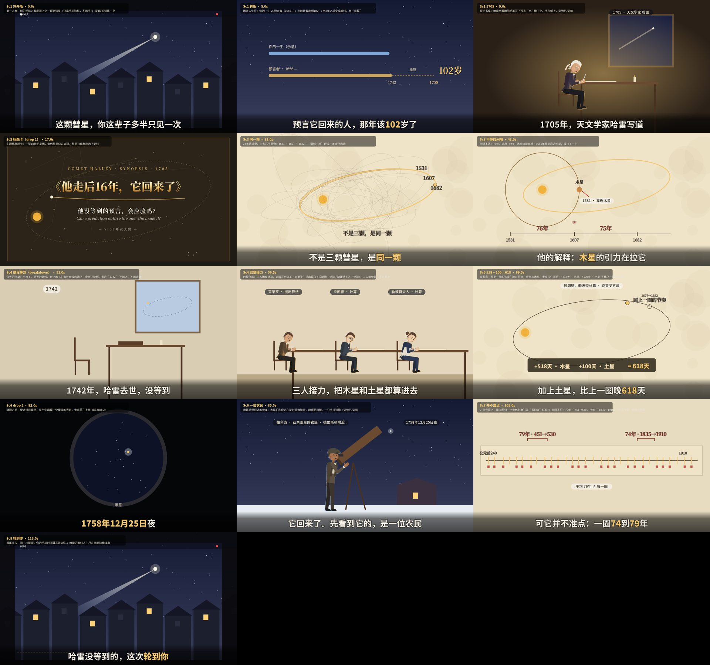

### Sc1 冷开场 · 0.6秒
第一人称：你的手机对着屋顶上空一颗亮彗星（只露手机边框，不画手）；踩第1拍彗尾一亮

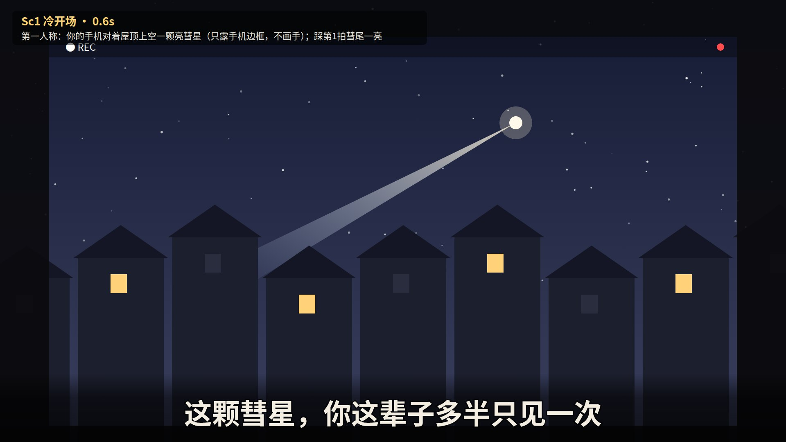

### Sc1 转折 · 5.0秒
两条人生尺：你的一生 vs 预言者（1656—）；年龄计数跑到102；1742年之后变成虚线，标“推算”

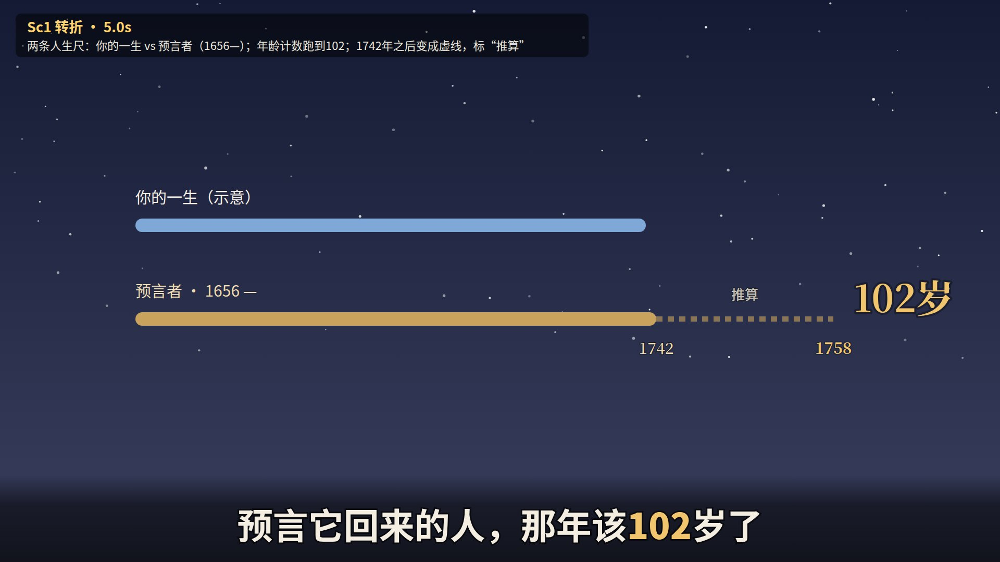

### Sc1 1705 · 9.0秒
烛光书桌：哈雷坐着用羽毛笔写下预言（坐在椅子上、手在纸上，姿势已校验）

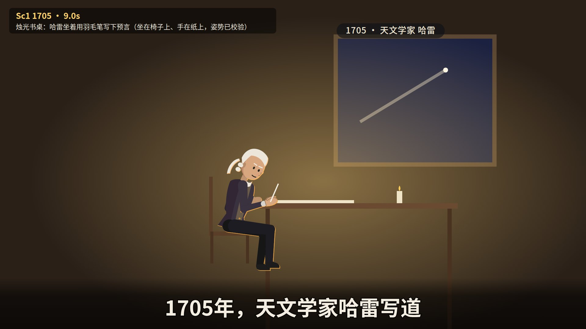

### Sc2 标题卡（drop 1） · 17.6秒
主题化标题卡：一页18世纪星图，金色彗星绕过太阳，彗尾扫成标题的下划线

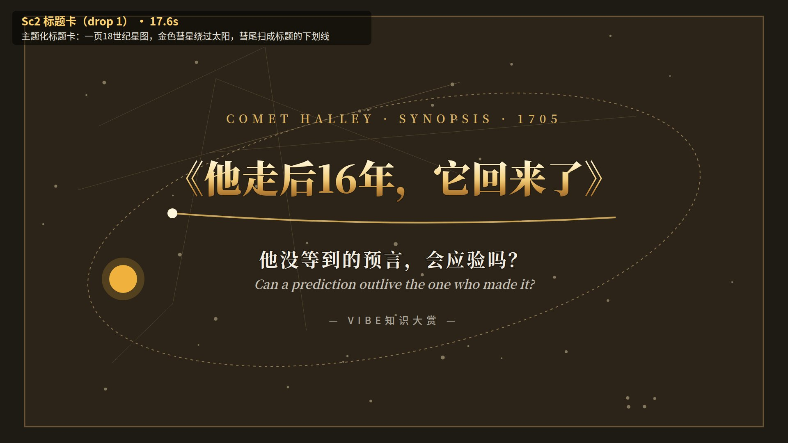

### Sc3 同一颗 · 33.0秒
24条轨道里，三条几乎重合：1531 · 1607 · 1682 —— 滑到一起，合成一条金色椭圆

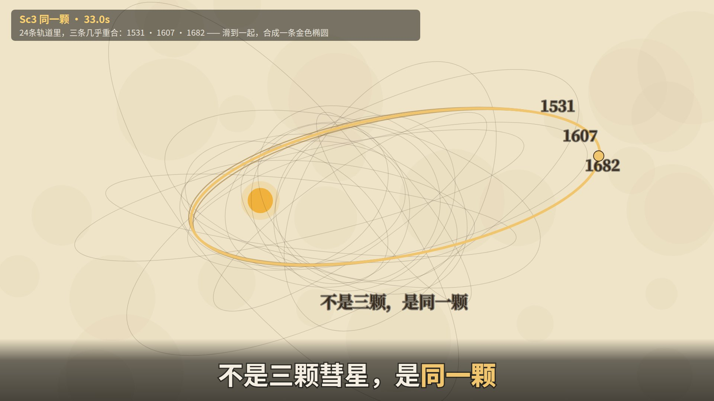

### Sc3 不等的间隔 · 43.0秒
间隔不等：76年、75年（≠）；木星轨道亮起，1681年彗星靠近木星，被拉了一下

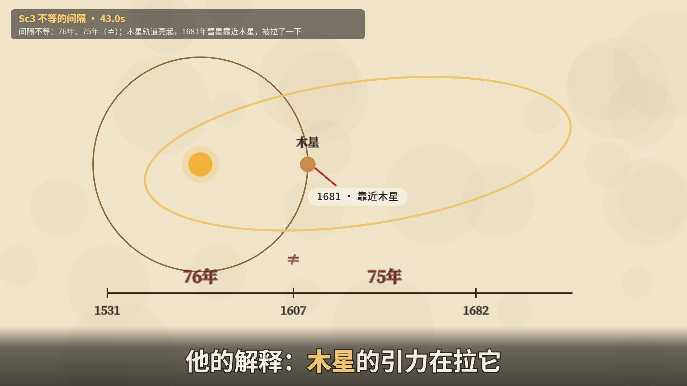

### Sc4 他没等到（breakdown） · 51.0秒
白天的书桌：空椅子、熄灭的蜡烛、合上的书；窗外虚线椭圆上，金点还没到。卡片“1742”（不画人、不画遗体）

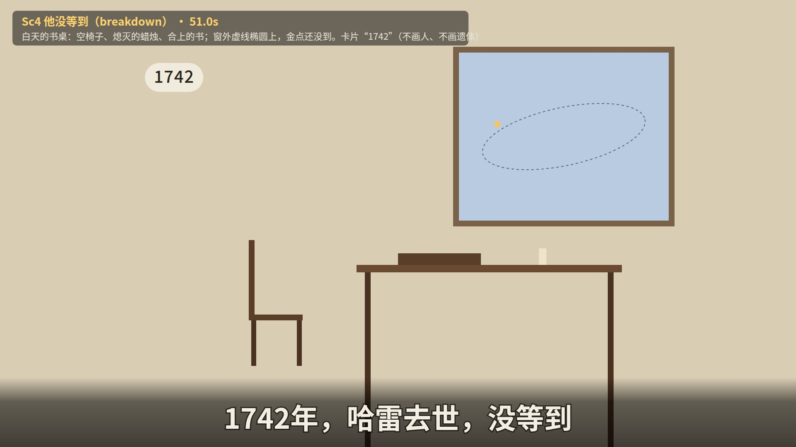

### Sc4 巴黎接力 · 56.5秒
巴黎书房：三人围桌计算，名牌写明分工（克莱罗·提出算法 / 拉朗德·计算 / 勒波特夫人·计算），三人都坐着、手在纸上

### Sc5 518 + 100 = 618 · 69.5秒
虚影点“照上一圈的节奏”跑在前面；金点被木星、土星拉住落后：+518天 · 木星，+100天 · 土星 → 比上一圈晚618天

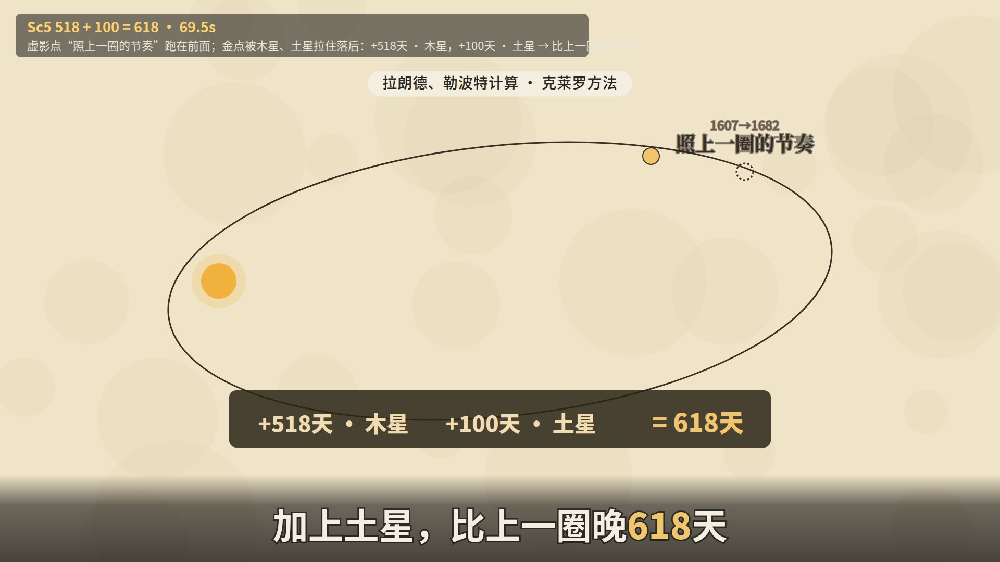

### Sc6 drop 2 · 82.0秒
静默之后：望远镜目镜里，星空中出现一个模糊的光斑，金点落在上面（踩 drop 2）

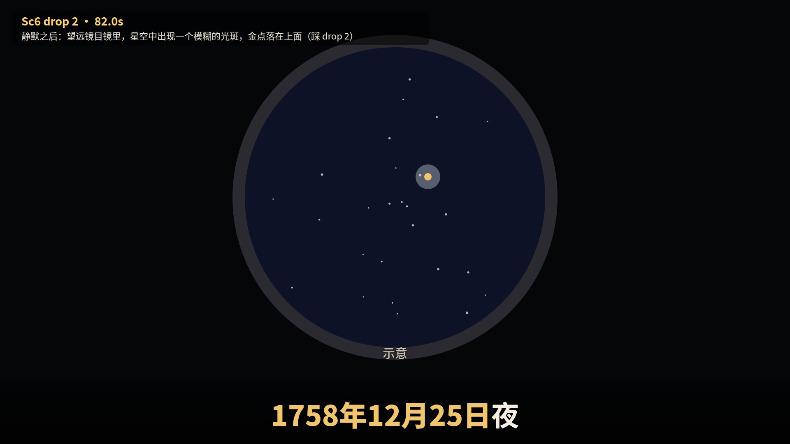

### Sc6 一位农民 · 85.5秒
德累斯顿附近的雪夜：农民帕利奇站在反射望远镜旁，眼睛贴目镜、一只手扶镜筒（姿势已校验）

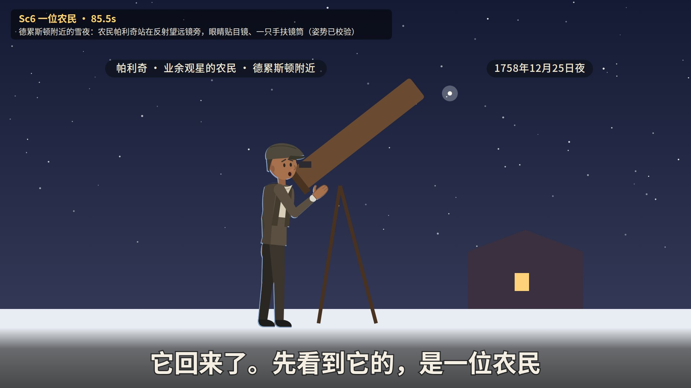

### Sc7 并不准点 · 105.0秒
史书长卷上，每次回归一个金色刻度（盖“有记录”红印）；间隔不均：79年 · 451→530，74年 · 1835→1910；“平均76年”缩成小标签

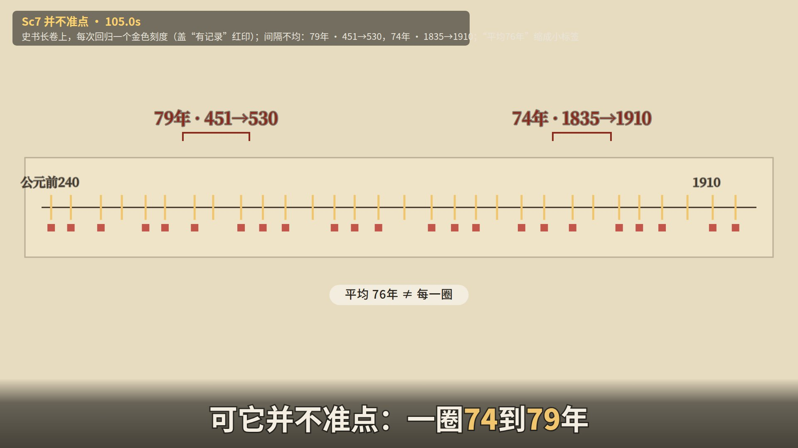

### Sc8 轮到你 · 113.5秒
首尾呼应：同一片屋顶，你的手机时间戳写着2061；哈雷的虚线人生尺在画面边缘淡出

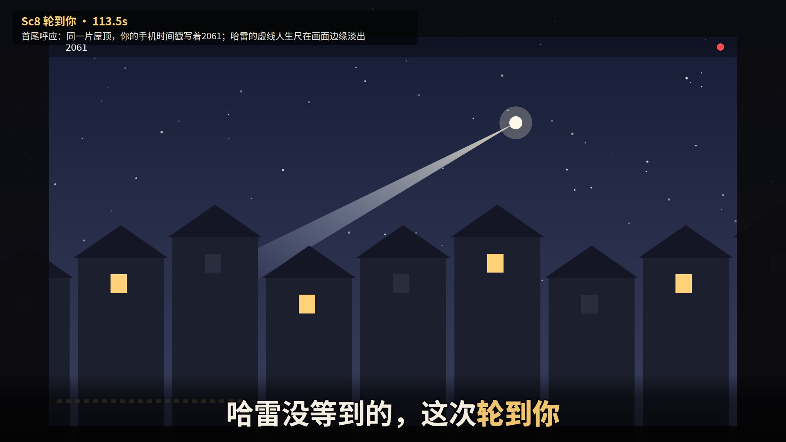

## 完整台词（时间轴）

| # | 开始 | 结束 | 台词（[金色]=重点词） | 所在场景 |
|---|---|---|---|---|
| 1 | 0.00 | 3.63 | 这颗彗星，你这辈子多半只见一次 | Sc1 |
| 2 | 3.73 | 7.22 | 预言它回来的人，那年该[102]岁了 | Sc1 |
| 3 | 7.32 | 10.38 | 1705年，天文学家哈雷写道 | Sc1 |
| 4 | 10.48 | 13.54 | 「斗胆预言：[1758]年它会回来」 | Sc1 |
| 5 | 13.64 | 16.40 | 要等[53]年，才有答案 | Sc1 |
| 6 | 20.80 | 24.45 | 如果彗星绕太阳转圈，就会回来 | Sc2 |
| 7 | 24.55 | 28.34 | 他用牛顿引力，算出[24]颗彗星轨道 | Sc2 |
| 8 | 28.44 | 31.66 | 其中三颗，轨道几乎一样 | Sc2 |
| 9 | 31.76 | 34.98 | 不是三颗彗星，是[同一颗] | Sc2 |
| 10 | 35.08 | 38.44 | 那就能算：它下次哪年回来 | Sc3 |
| 11 | 38.54 | 41.76 | 可间隔不等：76年，又75年 | Sc3 |
| 12 | 41.86 | 45.36 | 他的解释：[木星]的引力在拉它 | Sc3 |
| 13 | 45.46 | 48.95 | 所以他估计：1758年底到次年初 | Sc3 |
| 14 | 49.10 | 52.04 | 1742年，哈雷去世，没等到 | Sc3 |
| 15 | 52.14 | 55.65 | 巴黎：克莱罗、拉朗德、勒波特夫人 | Sc4 |
| 16 | 55.75 | 59.40 | 三人接力，把木星和土星都算进去 | Sc4 |
| 17 | 59.50 | 63.15 | 六个月从早算到晚，有时边吃边算 | Sc4 |
| 18 | 63.25 | 67.91 | 木星让这一圈，比上一圈晚[518]天 | Sc4 |
| 19 | 68.01 | 72.39 | 加上土星，比上一圈晚[618]天 | Sc4 |
| 20 | 72.49 | 77.15 | 预测[1759年4月中旬]最接近太阳 | Sc5 |
| 21 | 77.25 | 79.30 | 它会回来吗？ | Sc5 |
| 22 | 81.45 | 83.86 | [1758年12月25日]夜 | Sc5 |
| 23 | 83.96 | 87.37 | 它回来了。先看到它的，是一位农民 | Sc6 |
| 24 | 87.47 | 90.17 | 这时，哈雷已去世[16]年 | Sc6 |
| 25 | 90.27 | 93.25 | 1759年3月13日，最接近太阳 | Sc6 |
| 26 | 93.35 | 96.91 | 比预测早了约一个月，卡在误差边上 | Sc6 |
| 27 | 97.01 | 100.28 | 能确认的最早记录：公元前[240]年 | Sc6 |
| 28 | 100.38 | 103.51 | 此后，中国史书几乎次次记下 | Sc6 |
| 29 | 103.61 | 106.74 | 可它并不准点：一圈[74]到[79]年 | Sc6 |
| 30 | 106.84 | 110.11 | 所以下一次，也是这样算出来的 | Sc7 |
| 31 | 110.21 | 112.62 | 算出的答案：[2061]年 | Sc7 |
| 32 | 112.72 | 115.70 | 哈雷没等到的，这次[轮到你] | Sc7 |

## 资料

- 事实核查表：`facts.md`（每个数字都对应一行已核实的来源；没核实的不上屏）
- 英文工作版剧本（含每句画面说明、导演两轮意见）：`script.md`、`notes_gate1_r1.md`、`notes_gate1_r2.md`、`coldread_gate1.json`
- 下一步（等你确认标题和剧本后）：画风选择（gate 2a）→ 分镜 → 制作
