# 剧本：不数人头，怎么点兵？

*ep25 · VIBE知识大赏 · 约2分钟 · 横屏 · 只有字幕 · 系列BGM（标题落在 drop 1 = 16.6秒，揭晓落在 drop 2 = 81.4秒，片尾卡 115.9秒起）· 夜间无人值守生成，2026-10-12*

**推荐标题：《不数人头，怎么点兵？》**　备选：《韩信点兵，原文没有韩信》 / 《从点兵，到加密钥匙》  
**标题卡副标题：**三个小余数，拼回一个大数  
**片尾评论区问题：**韩信点兵这个说法，你第一次在哪听到？  
**一句话带走：**只看三次排队的余数，就能拼回人数——前提是除数两两互质、并且大概知道有多少人。

## 故事（三句话）

1. 军训报数，一百多人又报乱了。其实排三次队就够了：三人一排多2、五人一排多3、七人一排多2 → 128人。传说韩信就这样点兵——但最早的记载里没有韩信，"韩信点兵"是后来的传说。
2. 《孙子算经》（1600多年前）原文只说"今有物不知其数"，同样的余数，答案却是23。书里的方法：70、21、15，加起来233，减两个105得23。因为每隔105一个答案，23、128、233都对。1247年秦九韶写出通用解法「大衍求一术」：找个乘数，让余数剩1（35×2=70）。
3. drop 2：今天 RSA 加密的解密钥匙里存着 dP、dQ、qInv——标准里叫"CRT"，就是中国剩余定理：拆成 p、q 两个小计算更快，再用 qInv（一次"求一"）拼回来。前提：除数不能有公因数，而且要大概知道有多少。

## 需要你决定 / 注意

- 开场军训连队的"128人"是虚构的示意数字（选它是因为余数正好是2、3、2，和原书一致）。
- "韩信点兵是后来的传说"：依据是现存文献的年代（原书无韩信；杨辉1275称"秦王暗点兵"；程大位1592《算法统宗》才叫"韩信点兵"），这是推断，不是某个来源的原话。

## 关键帧（13张，Tank/池塘同款2D画风；所有人物都通过了身体逻辑检查）

总览：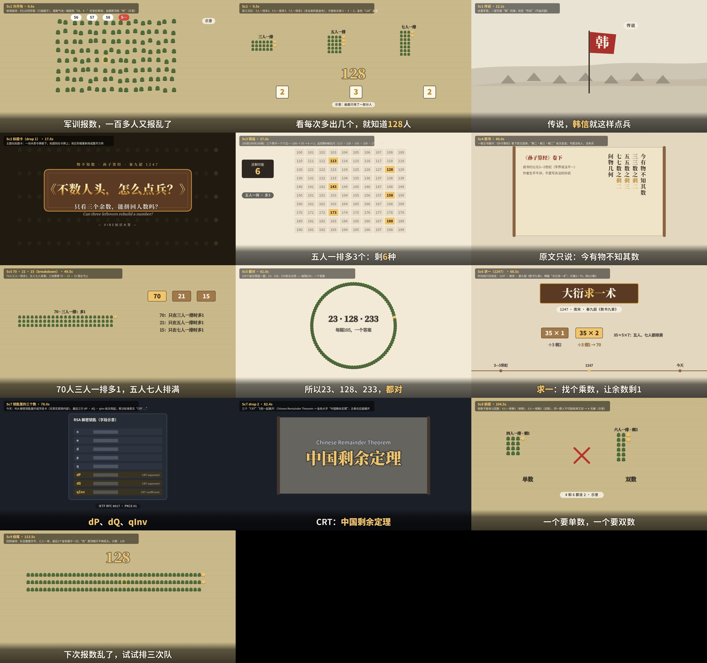

### Sc1 冷开场 · 0.6秒
俯视操场：约128顶军帽（只画帽子），报数气泡一路跑到“58、5…”时变红断掉；金圈那顶是“你”（示意）

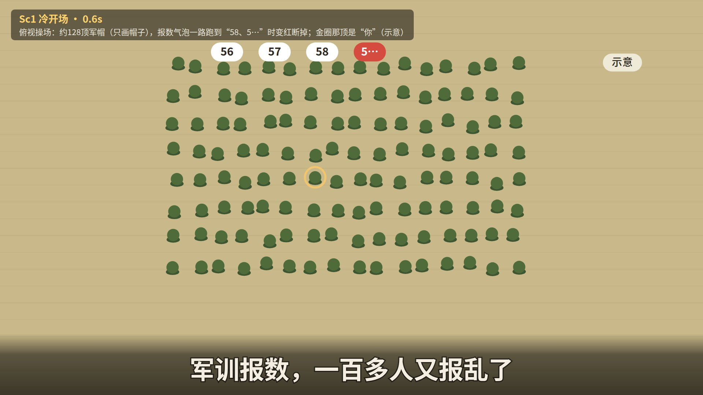

### Sc1 · 9.5秒
排三次队：3人一排多2、5人一排多3、7人一排多2（多出来的是金色）；方框依次填 2 · 3 · 2，金色“128”盖章

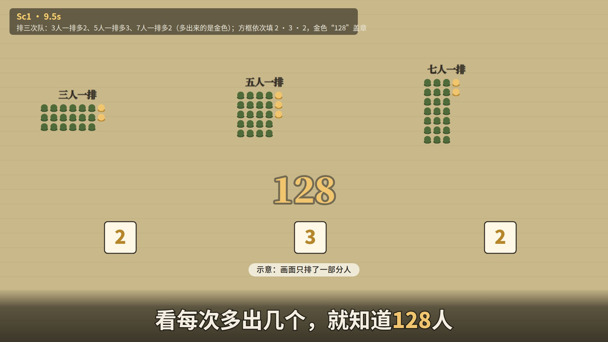

### Sc1 传说 · 12.2秒
水墨军营，一面写着“韩”的旗；标签“传说”（不画兵器）

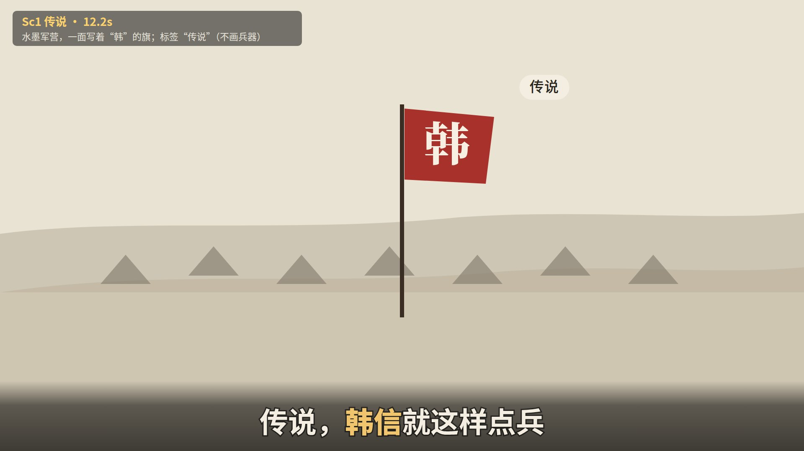

### Sc2 标题卡（drop 1） · 17.6秒
主题化标题卡：一块木质令牌砸下，标题刻在令牌上；背后军帽重新排成整齐方阵

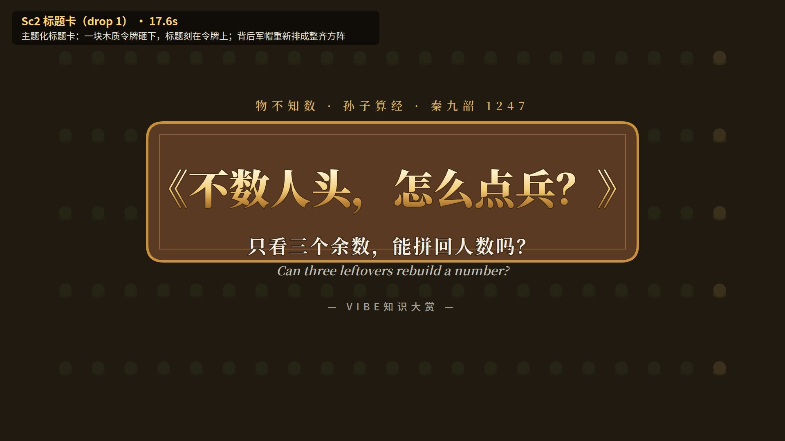

### Sc3 筛选 · 27.0秒
100到199共100格：三个筛子一个个过——100 → 33 → 6 → 1；此刻剩6格在闪（113 · 128 · 143 · 158 · 173 · 188）

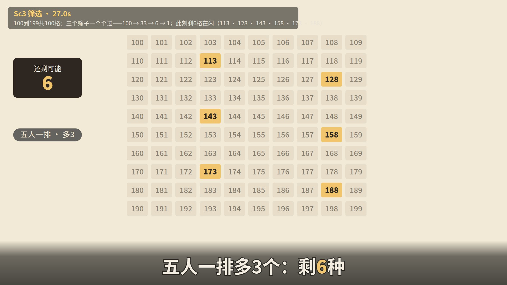

### Sc4 原书 · 40.0秒
一卷古书展开：《孙子算经》卷下原文竖排，“剩二·剩三·剩二”依次变金；书里没有人、没有兵

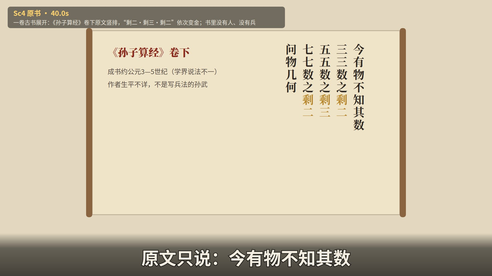

### Sc5 70 · 21 · 15（breakdown） · 49.5秒
70人三人一排多1、五人七人排满；三块算筹 70 · 21 · 15 落在书上

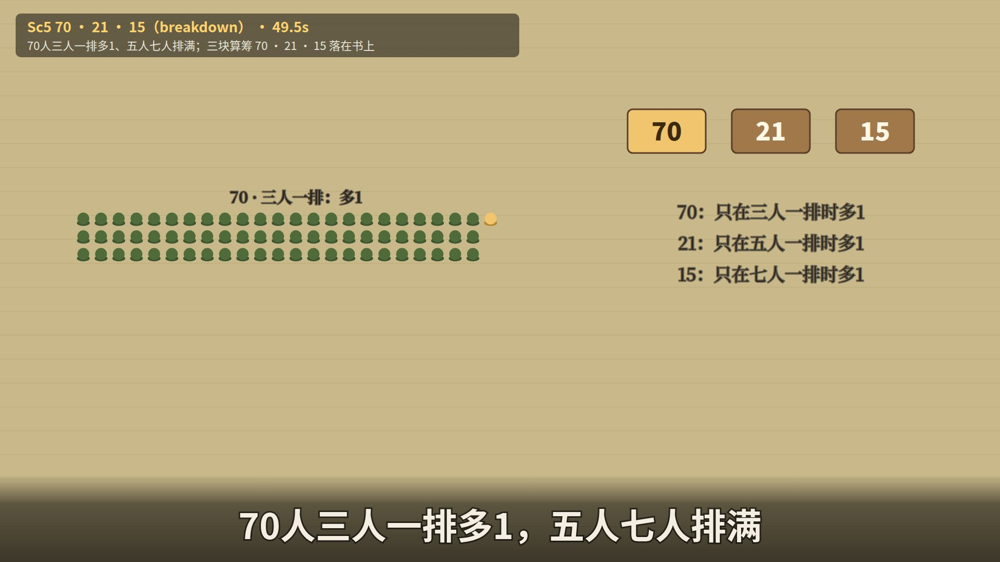

### Sc5 都对 · 61.0秒
105个座位围成一圈：23、128、233依次点亮 ——每隔105，一个答案

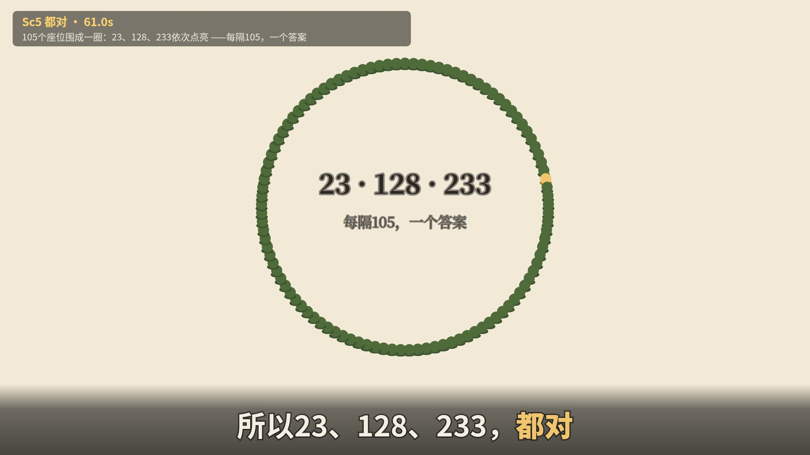

### Sc6 求一（1247） · 68.5秒
时间线只往前走：1247 · 南宋 · 秦九韶《数书九章》，牌匾“大衍求一术”；35乘2 = 70，除以3剩1

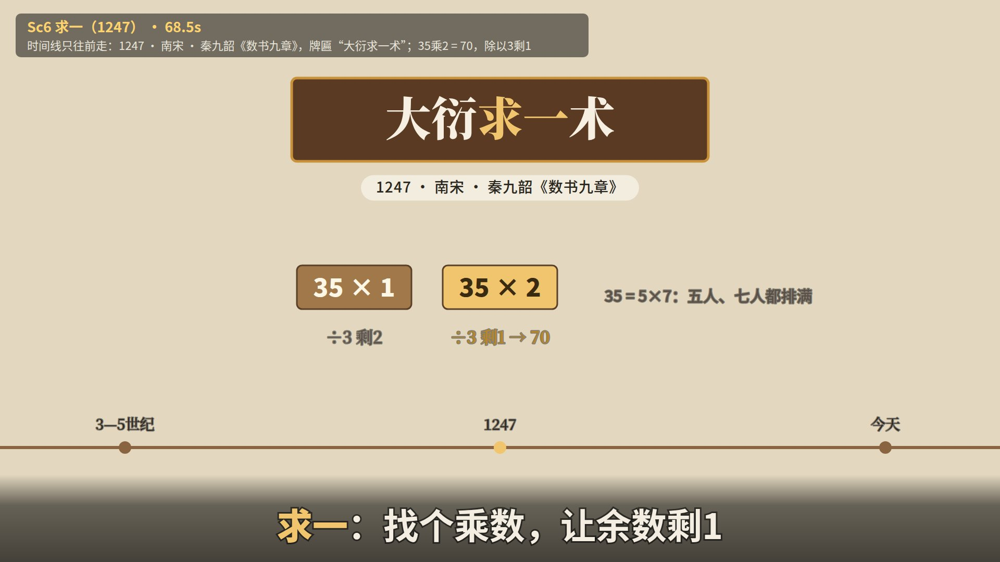

### Sc7 钥匙里的三个数 · 78.0秒
今天：RSA 解密钥匙展开成字段卡（无真实密钥内容），最后三行 dP · dQ · qInv 依次亮起，旁注标准原文“CRT …”

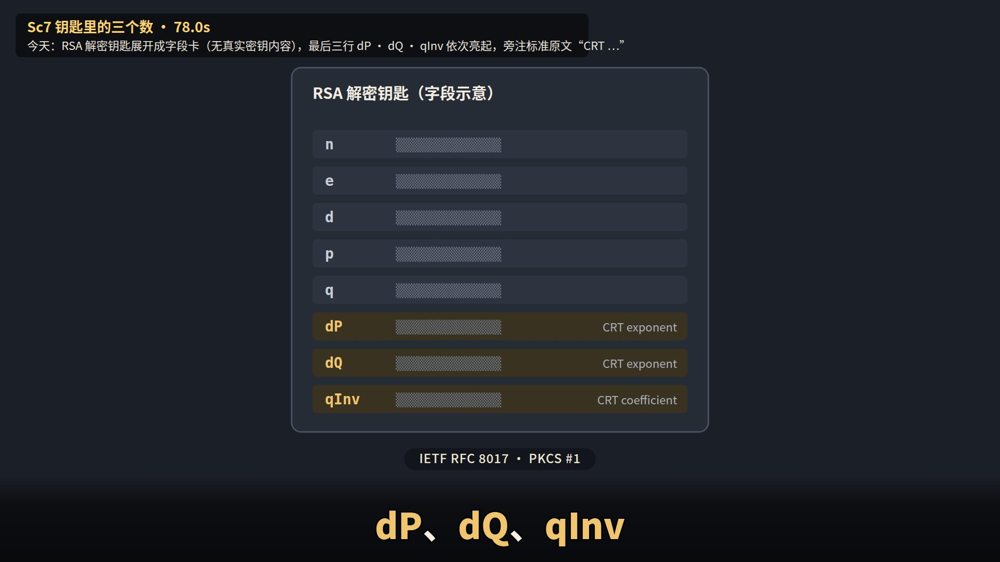

### Sc7 drop 2 · 82.4秒
三个“CRT”飞到一起展开：Chinese Remainder Theorem → 金色大字“中国剩余定理”；古卷在后面展开

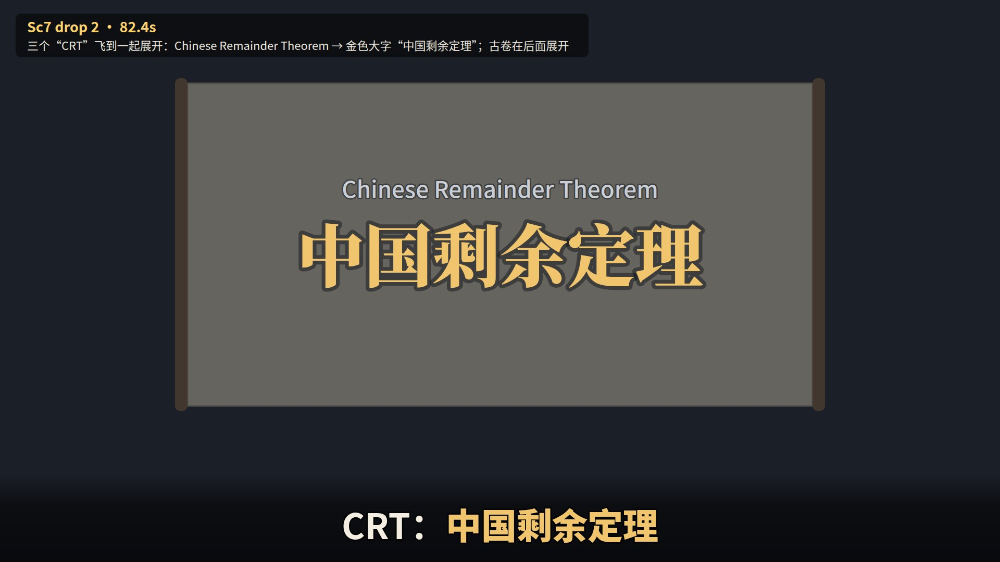

### Sc8 前提 · 104.5秒
除数不能有公因数：4人一排剩1（单数）、6人一排剩2（双数），同一群人不可能既单又双 → ✕ 无解（示意）

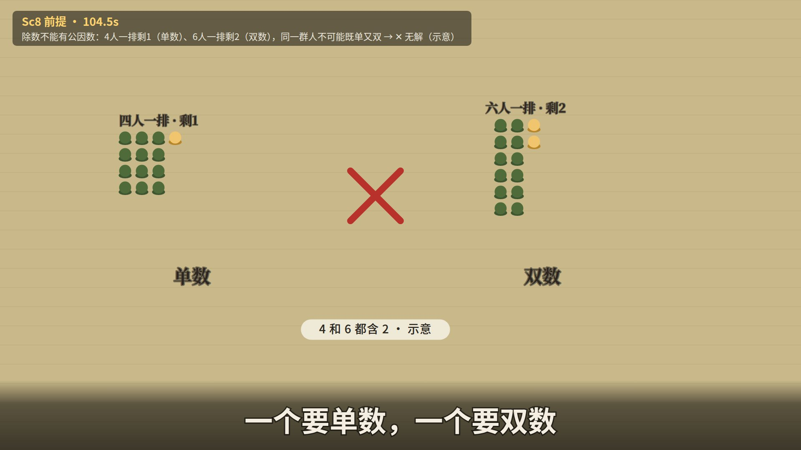

### Sc9 结尾 · 113.5秒
回到操场：队伍整整齐齐，三人一排，最后2个金色帽子一闪；“你”那顶帽子不再低头。计数：128

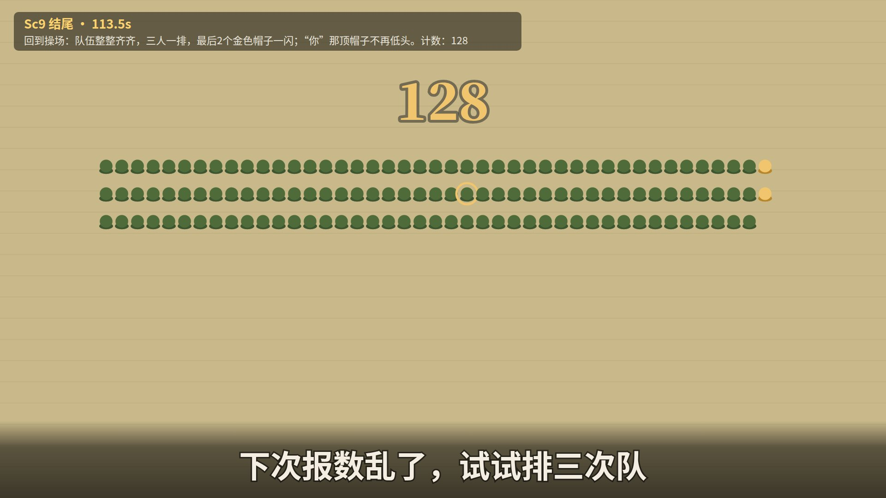

## 完整台词（时间轴）

| # | 开始 | 结束 | 台词（[金色]=重点词） | 所在场景 |
|---|---|---|---|---|
| 1 | 0.00 | 2.89 | 军训报数，一百多人又报乱了 | Sc1 |
| 2 | 2.99 | 5.45 | 第三遍了，还得从头报 | Sc1 |
| 3 | 5.55 | 8.01 | 其实，排[三次]队就够了 | Sc1 |
| 4 | 8.11 | 11.00 | 看每次多出几个，就知道[128]人 | Sc1 |
| 5 | 11.10 | 13.56 | 传说，[韩信]就这样点兵 | Sc1 |
| 6 | 13.66 | 16.40 | 今天，它还藏在加密[钥匙]里 | Sc1 |
| 7 | 20.70 | 22.98 | 从100到199，100种可能 | Sc2 |
| 8 | 23.08 | 25.64 | 三人一排多2个：剩[33]种 | Sc2 |
| 9 | 25.74 | 28.30 | 五人一排多3个：剩[6]种 | Sc2 |
| 10 | 28.40 | 30.96 | 七人一排多2个：只剩[128] | Sc3 |
| 11 | 31.06 | 33.77 | 可最早的记载里，没有[韩信] | Sc3 |
| 12 | 33.87 | 36.43 | [韩信点兵]，是后来的传说 | Sc3 |
| 13 | 36.53 | 38.82 | 《孙子算经》，1600多年前 | Sc3 |
| 14 | 38.92 | 41.63 | 原文只说：今有物不知其数 | Sc3 |
| 15 | 41.73 | 44.58 | 同样的余数，原书答案却是[23] | Sc4 |
| 16 | 44.68 | 47.24 | 原书先找三个数：70、21、15 | Sc4 |
| 17 | 47.34 | 51.34 | 70人三人一排多1，五人七人排满 | Sc4 |
| 18 | 51.44 | 54.15 | 多几个就拿几份，加起来[233] | Sc5 |
| 19 | 54.25 | 56.67 | 105人：三种排法都排满 | Sc5 |
| 20 | 56.77 | 59.05 | 233减两个105：正是[23] | Sc5 |
| 21 | 59.15 | 63.15 | 所以23、128、233，[都对] | Sc5 |
| 22 | 63.25 | 66.02 | 1247年，秦九韶写出通用解法 | Sc5 |
| 23 | 66.12 | 68.90 | [求一]：找个乘数，让余数剩1 | Sc5 |
| 24 | 69.00 | 71.77 | 35乘几，除以3剩1？乘2：[70] | Sc6 |
| 25 | 71.87 | 74.64 | 到今天，[RSA]加密也在算余数 | Sc6 |
| 26 | 74.74 | 77.66 | 解密钥匙里，还多存了三个数 | Sc6 |
| 27 | 77.76 | 79.38 | [dP]、[dQ]、[qInv] | Sc6 |
| 28 | 81.45 | 86.77 | CRT：[中国剩余定理] | Sc7 |
| 29 | 86.87 | 89.90 | 解密：拆成p、q两个小计算，更快 | Sc7 |
| 30 | 90.00 | 92.76 | 再用[qInv]，把两个结果拼回来 | Sc7 |
| 31 | 92.86 | 95.47 | q乘qInv，除以p正好剩[1] | Sc7 |
| 32 | 95.57 | 98.04 | 这正是秦九韶的[求一] | Sc7 |
| 33 | 98.14 | 101.03 | 不过，除数之间不能有公因数 | Sc7 |
| 34 | 101.13 | 104.03 | 比如除4剩1、除6剩2：[无解] | Sc7 |
| 35 | 104.13 | 106.74 | 一个要单数，一个要双数 | Sc7 |
| 36 | 106.84 | 109.59 | 而且，得先知道[大概]有多少 | Sc8 |
| 37 | 109.70 | 112.30 | 所以一百多人，只能是[128] | Sc8 |
| 38 | 112.40 | 115.30 | 下次报数乱了，试试排三次队 | Sc8 |

## 资料

- 事实核查表：`facts.md`（每个数字都对应一行已核实的来源；没核实的不上屏）
- 英文工作版剧本（含每句画面说明、导演两轮意见）：`script.md`、`notes_gate1_r1.md`、`notes_gate1_r2.md`、`coldread_gate1.json`
- 下一步（等你确认标题和剧本后）：画风选择（gate 2a）→ 分镜 → 制作
